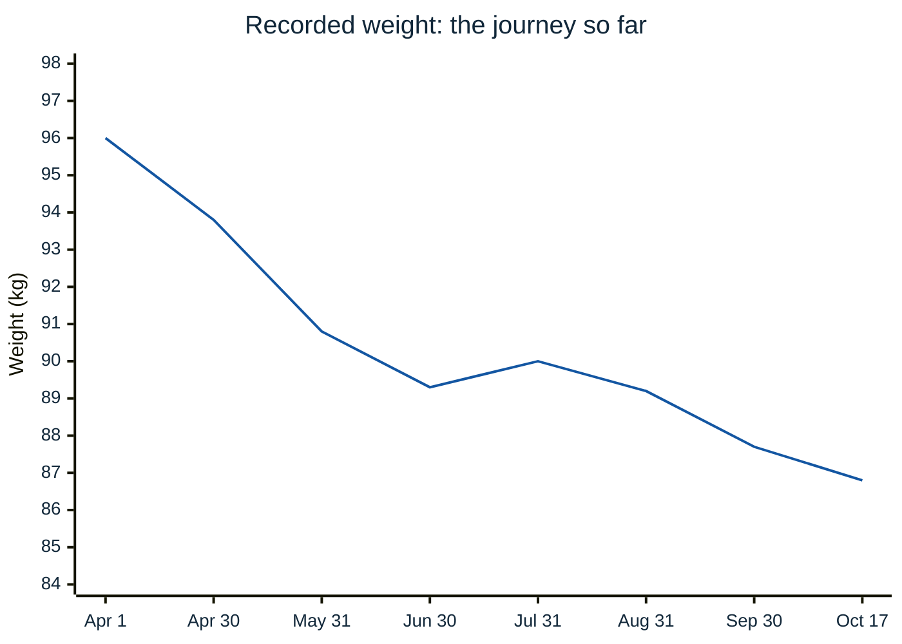
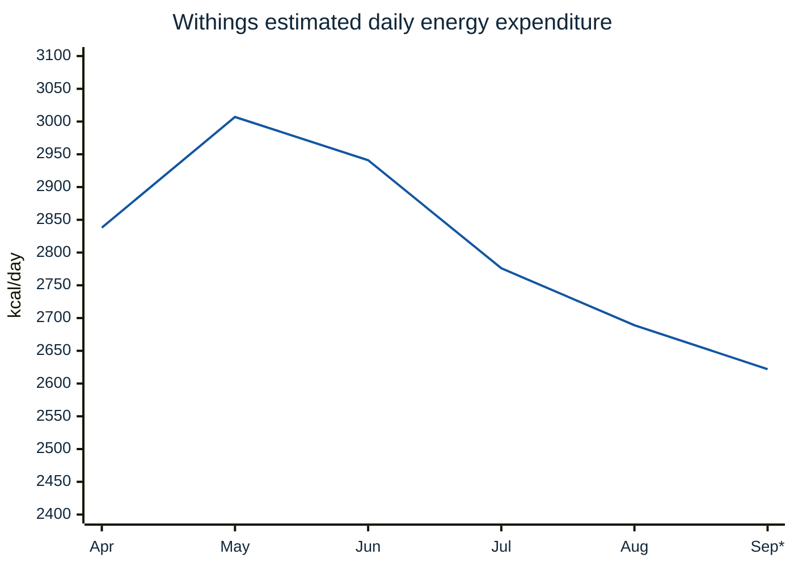
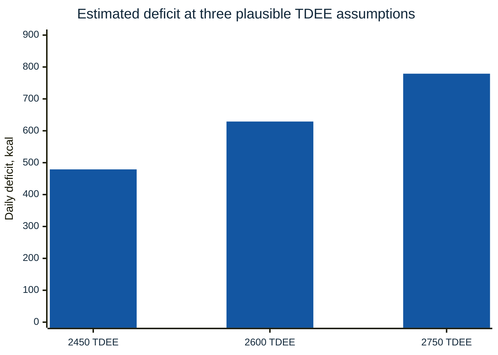
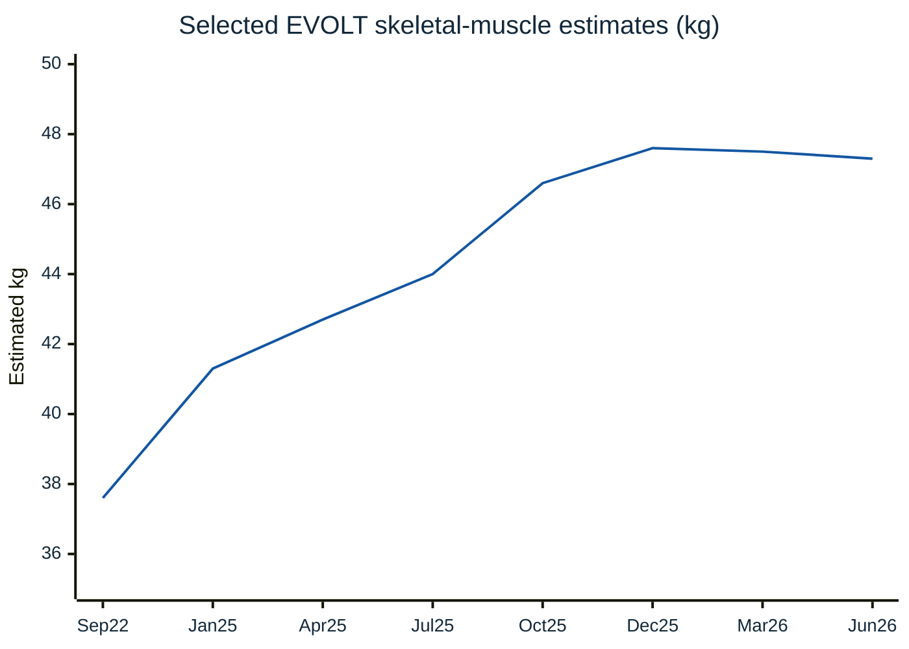
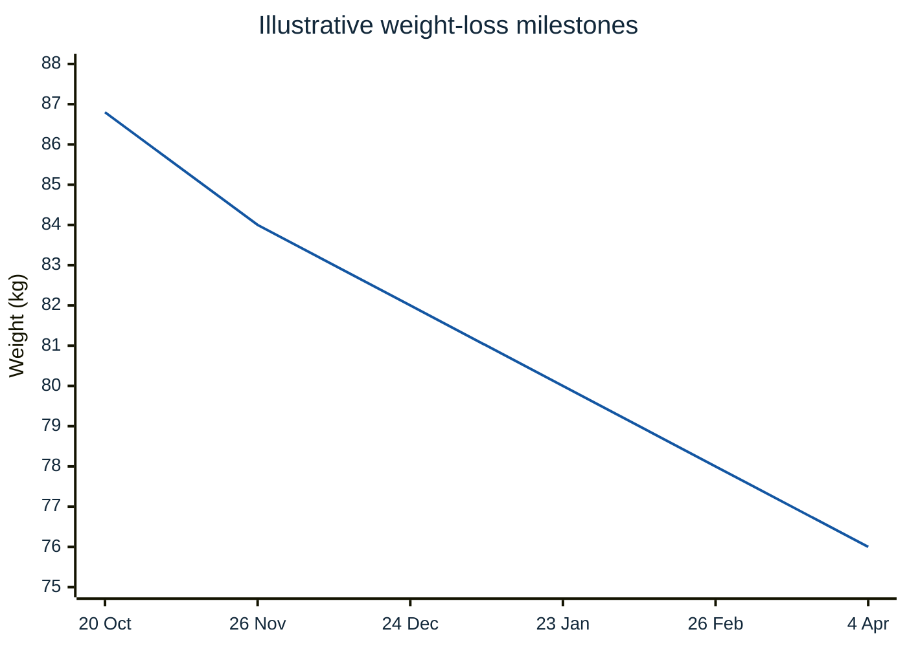
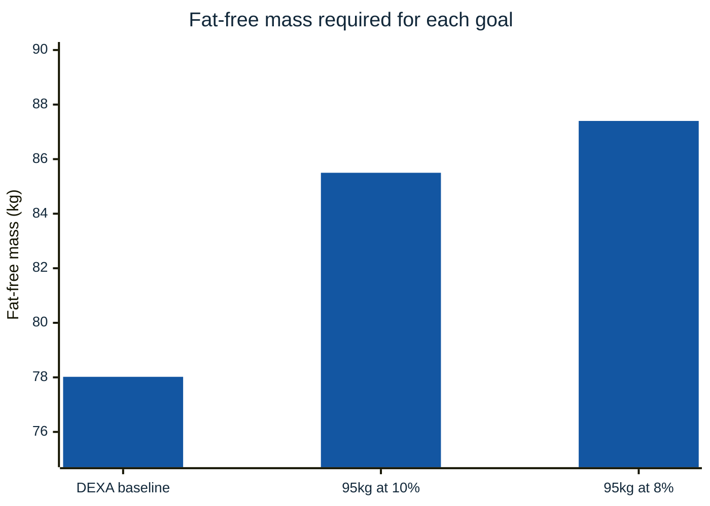
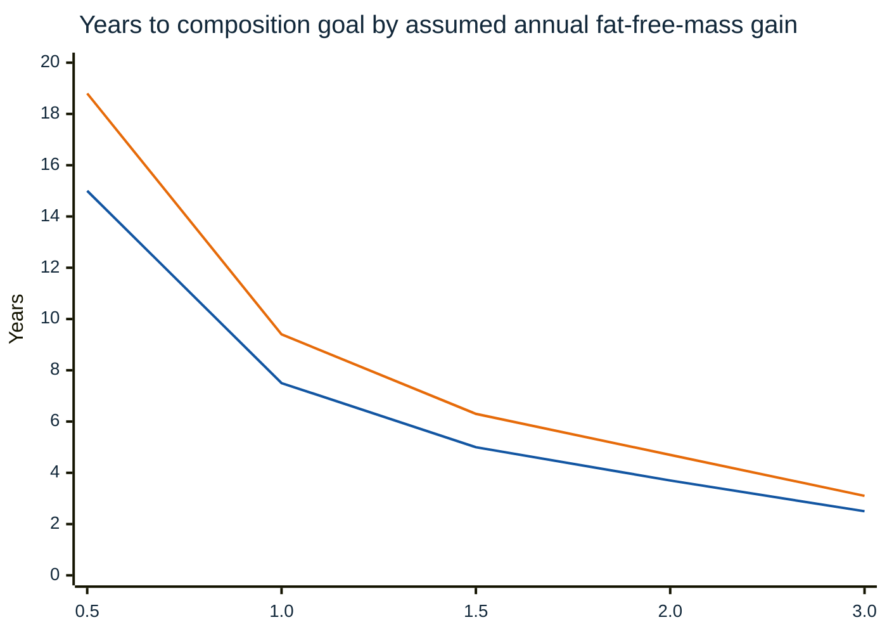
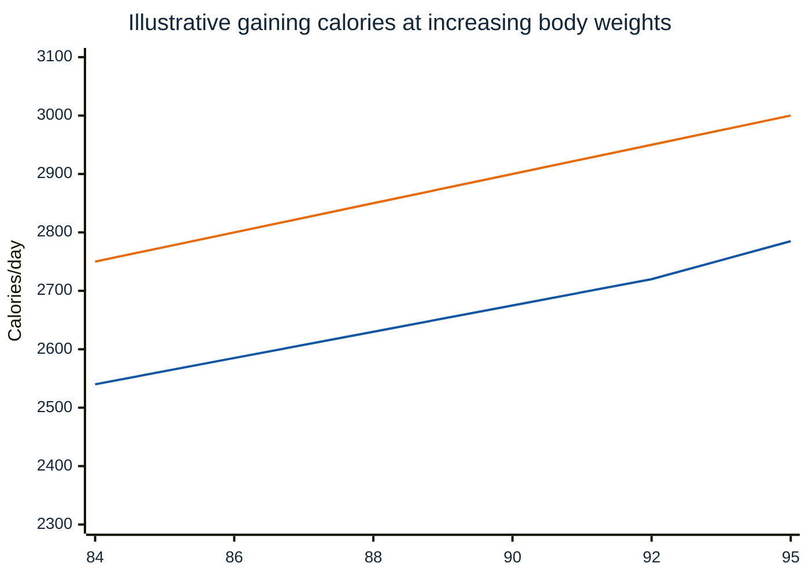
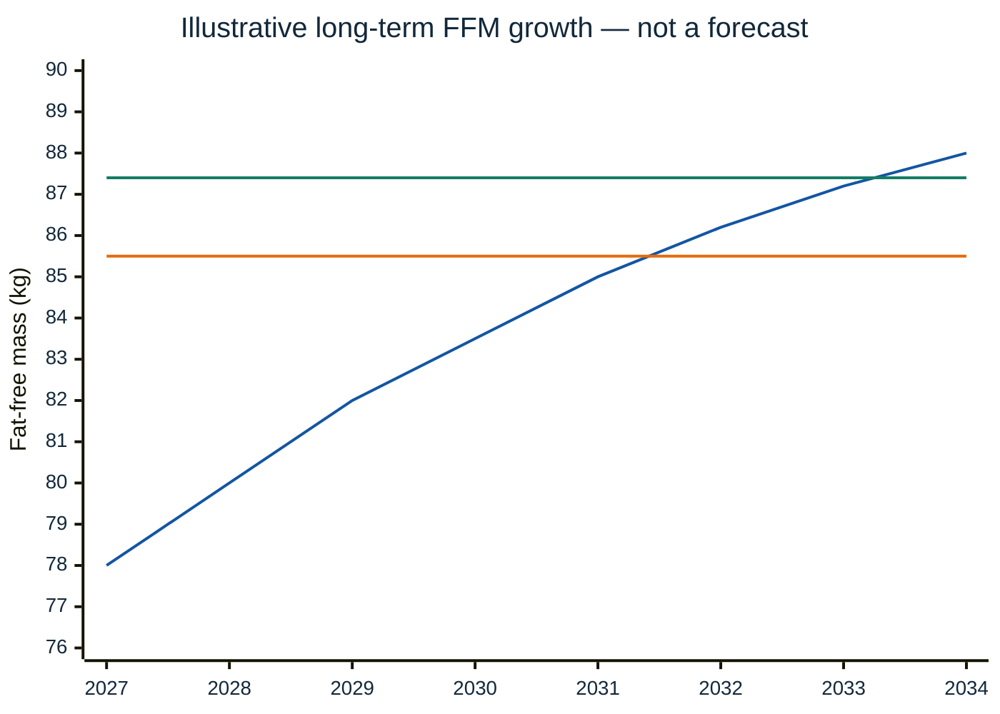

# My fitness journey: from 96 kg to a leaner, stronger 95 kg

*A data-driven personal plan, drafted 20 October 2026. This is a snapshot, not a medical recommendation or a guarantee.*

## At a glance: the numbers behind the plan

| Category | Result | What it means |
| --- | ---: | --- |
| Starting weight (1 April 2026) | **96.0 kg** | Beginning of the tracked period |
| Latest recorded weight (17–20 October 2026) | **86.8 kg** | **−9.2 kg**, approximately **−9.6%** |
| Height used in composition calculations | **177 cm** | The basis for FFMI |
| Daily Withings records reviewed | **164 days** | April 1–September 11, not a full year |
| Individual exercise sessions exported | **372** | Over the same available Withings period |
| Withings average total expenditure | **2,834 kcal/day** | Historical *wearable estimate*, not current TDEE |
| Withings median total expenditure | **2,802 kcal/day** | More robust to unusually active days |
| Withings average active calories | **949 kcal/day** | **Already included** in total expenditure |
| Withings average steps | **6,607/day** | Historical average, not a daily step target |
| Current modelled TDEE | **2,600 kcal/day** | Best provisional working estimate at 86.8 kg |
| TDEE planning uncertainty | **2,450–2,750 kcal/day** | Reasonable sensitivity range, not a measured confidence interval |
| DEXA scan | **7 September 2026** | Strongest body-composition reference in the workbook |
| DEXA fat-free mass | **78.021 kg** | 74.805 kg lean soft tissue + 3.216 kg bone mineral |
| Goal composition — 10% | **85.5 kg fat-free mass** | +7.48 kg from DEXA |
| Goal composition — 8% | **87.4 kg fat-free mass** | +9.38 kg from DEXA |

This is the central distinction throughout the report: **observed weight**, **wearable-estimated energy use**, **DEXA-estimated composition**, and **hypothetical future growth** are four different kinds of evidence. They cannot be treated as equally certain.

### Three chapters of the journey

| Period | Focus | Objective |
| --- | --- | --- |
| **April–late 2026** | Fat loss, resistance training, rebuilding consistency | Reach an appropriate level of leanness while preserving strength and lean mass |
| **After cutting through April 2027** | Maintenance | Prove that weight, training and intake can be held relatively stable |
| **April 2027 onward** | Controlled muscle gain and periodic reassessment | Add measurable lean mass while monitoring body-fat gain and health |

---

## Where I started, and where I am

In April 2026, I weighed **96.0 kg**. By **17 October 2026**, my most recently recorded weight was **86.8 kg**, a reduction of **9.2 kg (9.6%)**. My weight has not dropped in a straight line. There have been periods of disciplined dieting and periods when I didn't track my meals, particularly over the middle of the year.

| Milestone | Weight | Meaning |
| --- | ---: | --- |
| 1 April 2026 | 96.0 kg | Opening recorded weight |
| 7 September 2026 | 90.4 kg | DEXA body-composition scan |
| 17 October 2026 | 86.8 kg | Most recent changed scale reading |
| April 2027 | To be decided | Start of a controlled muscle-gain phase |
| Long-term | 95.0 kg at 10% or 8% body fat | Ambitious composition goal |

### The scale tells a story, but not the whole story

*Monthly readings show checkpoints, not an uninterrupted decline. Some entries in the exported weight series are carried forward between weigh-ins.*

## How my diet and activity fit together

My intended cutting diet is **1,800 calories per day**. On weeks when I eat out twice, the plan assumes roughly **600 additional calories per meal compared with the planned meal**, which makes the *effective* daily average approximately **1,971 kcal**.

But missing food records cannot be interpreted as zero calories. From 203 diary days, **135** include some food entries, **68** have none, and many of the logged days may be partial. Those gaps mean the diary does not prove exactly how much I ate on average.

My Withings activity export, covering **1 April to 11 September 2026**, estimates approximately **2,834 kcal/day** total expenditure across its records. It also shows estimated expenditure declining as my weight and activity changed:

| Month | Wearable-estimated TDEE (kcal/day) |
| --- | ---: |
| April | 2,838 |
| May | 3,007 |
| June | 2,941 |
| July | 2,776 |
| August | 2,689 |
| September 1–11 | 2,622 |

*Withings totals include activity calories; workout calories must not be added again. September covers only 11 days. Devices estimate energy use, rather than measure it directly.*

### My current TDEE estimate

My working estimate at **86.8 kg** is **2,600 kcal/day**, with a planning range of **2,450–2,750**. It's a calibrated starting assumption from past wearable data, **not a validated metabolic measurement**. My actual rate of weight change during several weeks of complete tracking will matter more.

## How I estimated TDEE — what changed as better data arrived

TDEE stands for **total daily energy expenditure**: the average calories burned across resting metabolism, movement, exercise and digestion. It is the quantity to compare with *all* dietary energy consumed across a day.

The estimate evolved as more data became available:

| Stage of analysis | Working estimate | Why |
| --- | ---: | --- |
| Initial planning estimate | **2,700 kcal/day** | An early activity-and-body-weight assumption before reviewing the recent Withings export |
| First Withings ZIP, older period | **2,500 kcal/day** | 89 wearable days from **7 Dec 2025 to 6 Mar 2026** averaged **2,543** |
| Corrected Withings ZIP, overlapping diet period | **2,600 kcal/day** | 164 days from **1 Apr to 11 Sep 2026** averaged **2,834**, but expenditure was declining and body mass was lower by October |
| Final estimate for now | **2,600 kcal/day; test 2,450–2,750** | No complete recent October wearable series or consistently complete intake record to validate it |

The first ZIP had the wrong timeframe for comparing current exercise to the April–October food diary. The replacement exported 164 activity days and 372 workouts. That corrected the analysis; it did **not** prove that 2,834 is today's burn rate.

### The recent Withings dataset in more detail

| Metric from the April–September export | Value |
| --- | ---: |
| Number of daily activity records | **164** |
| Average total expenditure | **2,834 kcal/day** |
| Median total expenditure | **2,802 kcal/day** |
| Average active expenditure | **949 kcal/day** |
| Average steps | **6,607/day** |
| Workouts captured | **372** |
| Mean workout calories | **~212 kcal/session** |
| Average in last 60 recorded days | **~2,641 kcal/day** |
| August average | **2,689 kcal/day** |

The difference between the historical average and the last 60 days is important. Calorie expenditure changes with body size, steps, workout effort and other factors. A six-month average over a changing cut is not a measurement of maintenance calories at the end.

May's approximate **3,007 kcal/day** compared with August's **2,689 kcal/day** is a **318 kcal/day difference**. That is compatible with a lighter body, altered activity and other changes, but cannot be cleanly assigned to one cause. September's short, 11-day sample is less robust: its final record was unusually low at **1,356 total calories**, which may represent an incomplete day.

### A model of today's calories, not a claim of certainty

| Assumed current TDEE | If averaging 1,971 kcal eaten/day | Modelled starting deficit | Approx. starting weekly loss* |
| --- | ---: | ---: | ---: |
| **2,450 kcal/day** | 1,971 | 479 kcal/day | **0.44 kg/week** |
| **2,600 kcal/day** | 1,971 | 629 kcal/day | **0.57 kg/week** |
| **2,750 kcal/day** | 1,971 | 779 kcal/day | **0.71 kg/week** |

*The weekly-loss calculation divides seven days of energy deficit by an assumed 7,700 kcal/kg. It is a simplistic planning approximation. Scale weight is also affected by water, glycogen and gastrointestinal contents. Energy expenditure is expected to change during weight loss.*

### An independent way to audit wearable estimates

Over a *multiweek* period with reasonably complete calorie logs, the energy-balance approximation is:

> **Implied TDEE ≈ average daily intake + (weekly weight loss in kg × 7,700 ÷ 7)**

For example, if average actual intake were **1,970 kcal/day**:

| Average weight lost/week | Approx. implied TDEE |
| --- | ---: |
| 0.3 kg | 2,300 kcal/day |
| 0.4 kg | 2,410 kcal/day |
| 0.5 kg | 2,520 kcal/day |
| 0.6 kg | 2,630 kcal/day |
| 0.7 kg | 2,740 kcal/day |

This is useful for *calibrating* Withings. It is not possible to apply reliably using diary days with missing meals and no clear weight-trend window. A few weeks of complete intake data, stable activity and morning weigh-ins would meaningfully narrow the present estimate.

### Why I don't add workout calories

A workout might be labelled **212 kcal** in the exercise export, and the daily summary might separately show **949 active calories** on average. Both are estimates of energy already incorporated in Withings' **total calories**. Adding either on top of the 2,834 total would double-count energy and artificially inflate the projected calorie deficit.

---

## What my MyFitnessPal data can and cannot establish

My logs have useful food and macro information, but **coverage is the main limitation**.

| Diary coverage, 1 Apr–20 Oct 2026 | Days |
| --- | ---: |
| Calendar days in export | **203** |
| At least one food entry | **135** |
| No food entries | **68** |
| Share of days with any entries | **~66.5%** |
| Share with none | **~33.5%** |

An export of `0 calories` on a day with `0 food_entries` means **untracked**, not fasting. Likewise, a 900-calorie logged day might be incomplete rather than a genuine 900-calorie intake. The analysis notebook flags particularly low logged days for review; the threshold is a data-quality heuristic, not a judgment about someone's diet.

When comparing food to energy expenditure, only the overlapping dates with plausible logging can be examined—and even those are not guaranteed to be complete. This is why the report gives **forecast scenarios rather than an exact, retrospectively measured average deficit**.

### How I intend to eat during the remainder of the cut

| Element | Planning assumption |
| --- | --- |
| Normal-day intake | 1,800 kcal |
| Meals out per week | 2 |
| Additional calories assumed per meal out | 600 kcal **above** the regular planned meal |
| Extra calories per week | 1,200 kcal |
| Effective weekly intake | 13,800 kcal |
| Effective daily average | **1,971 kcal/day** |

The distinction between *additional* calories and *total* restaurant-meal calories is essential. The model assumes two higher-calorie meals add 1,200 kcal to a week already budgeted at 1,800 kcal/day. Actual restaurant portions, alcohol, snacks and imperfect logging could make the difference larger.

This plan is a **model input** rather than proof of what I've eaten, and I wouldn't lower calories further in response to a short-term weight stall without first reviewing intake completeness, activity, health and training performance.

---

## Body composition: why DEXA changed the strategy

The September DEXA provides a more credible anchor for absolute composition than any single EVOLT body-impedance reading. My workbook contains **18 EVOLT records** between September 2022 and June 2026 alongside the DEXA.

| Scan | Body weight | Fat mass | Fat-free mass | Estimated body fat |
| --- | ---: | ---: | ---: | ---: |
| EVOLT, **15 June 2026** | 93.3 kg | ~9.1 kg | ~84.2 kg | **9.8%** |
| DEXA, **7 September 2026** | 90.4 kg | **12.424 kg** | **78.021 kg** | **14.2%** |

These were three months apart, so the roughly **6.2 kg difference in estimated fat-free mass** cannot be described as a measured device error or as true muscle lost. Changes in hydration, carbohydrate stores, training state, body weight and the methods themselves all complicate comparisons.

**DEXA composition breakdown**

| Component | September DEXA |
| --- | ---: |
| Lean soft tissue | 74.805 kg |
| Bone mineral content | 3.216 kg |
| Fat-free mass, including bone | **78.021 kg** |
| Fat mass | 12.424 kg |
| Reported total mass | ~90.4 kg |
| Reported body fat | **14.2%** |

The EVOLT skeletal-muscle series also tells an interesting story, but it must be read as an *estimate*:

| EVOLT date | Estimated skeletal muscle |
| --- | ---: |
| September 2022 | 37.6 kg |
| January 2025 | 41.3 kg |
| April 2025 | 42.7 kg |
| July 2025 | 44.0 kg |
| October 2025 | 46.6 kg |
| December 2025 | 47.6 kg |
| March 2026 | 47.5 kg |
| June 2026 | 47.3 kg |

The readings rose substantially through late 2025 and then levelled off. That may reflect real progress, but I cannot claim every kilogram was newly developed muscle, nor use the same slope to predict future years of growth. The recent plateau matters when thinking about how demanding my next goal will be.

### What the September DEXA implies for additional cutting

If I had preserved exactly **78.021 kg** fat-free mass while losing body weight, the following would be the *mathematically implied* fat percentages:

| Scale weight | Body fat if fat-free mass were still 78.021 kg | Interpretation |
| --- | ---: | --- |
| 86.8 kg | ~10.1% | Conditional estimate, not a new scan |
| 84 kg | ~7.1% | Already extremely lean |
| 82 kg | ~4.9% | Too low to use casually as a target |
| 80 kg | ~2.5% | Excessively lean |
| 78 kg | Near zero | Not a realistic stable composition |
| 76 kg | Negative implied fat mass | **Impossible without losing fat-free mass** |

This is the key reason my plan now includes a body-composition checkpoint near **84 kg** and **does not treat 76 kg as a recommended destination**. Fat-free mass can fluctuate during dieting because it includes tissue, glycogen and water; repeat assessment is more informative than extrapolating one scan.

---

## The remainder of the cut

Under a simple energy-balance model starting on **20 October 2026**, with an effective intake of ~1,971 kcal/day, starting TDEE of 2,600 and an assumed reduction in expenditure of 22 kcal/day for each kilogram lost:

| Target | Illustrative arrival date | Difference from 86.8 kg |
| --- | --- | ---: |
| 84 kg | 26 Nov 2026 | −2.8 kg |
| 82 kg | 24 Dec 2026 | −4.8 kg |
| 80 kg | 23 Jan 2027 | −6.8 kg |
| 78 kg | 26 Feb 2027 | −8.8 kg |
| 76 kg | 4 Apr 2027 | −10.8 kg |

**A critical qualification:** these are *mathematical what-if targets*, not a recommendation to reach 76 kg. My September DEXA shows approximately **78.0 kg fat-free mass**. If that quantity were fully maintained, reaching 80 kg would imply dangerously little remaining fat; at 76 kg the arithmetic would be impossible. A repeat DEXA and a health assessment should determine when this cut stops. In practice, the plan is to **reassess at around 84 kg** rather than insist on the lowest scale number.

## Maintaining until April 2027

The idea is to hold a stable, sustainable body weight through April, rebuild consistency around training and food, and enter a gaining phase from a well-measured baseline.

| If I maintain at… | Estimated maintenance calories per day |
| --- | ---: |
| 84 kg | 2,540 |
| 82 kg | 2,495 |
| 80 kg | 2,450 |
| 78 kg | 2,405 |
| 76 kg | 2,360 |

*These are hypothetical maintenance values, not endorsements of all the target weights. They assume similar daily activity and an expenditure change of roughly 22 kcal/day per kg.*

My practical approach: raise intake toward estimated maintenance when I finish the cut, accept the normal initial water/glycogen rebound, track seven-day weight averages, and adjust by around 100–150 kcal/day if a trend persists over several weeks.

## The maintenance chapter: how I plan to use the months before April 2027

The point of maintenance isn't simply to stop dieting. It's a chance to stabilise training performance, hunger, energy, recovery and the accuracy of my calorie estimates **before deliberately creating a surplus**.

Using a starting TDEE of **2,600 kcal at 86.8 kg**, the planning model subtracts about **22 kcal/day per kg lost**:

| Stable weight | Estimated calories/day | Calories/week | Difference from 86.8 kg |
| --- | ---: | ---: | ---: |
| **84 kg** | **2,540** | 17,780 | −2.8 kg |
| 82 kg | 2,495 | 17,465 | −4.8 kg |
| 80 kg | 2,450 | 17,150 | −6.8 kg |
| 78 kg | 2,405 | 16,835 | −8.8 kg |
| 76 kg | 2,360 | 16,520 | −10.8 kg |

These are **scenario values**, not recommendations to reach the lower weights. Given the DEXA information, **84 kg is the first reassessment point, not an instruction to keep cutting afterward**.

### What switching to maintenance will look like

1. **On finishing the cut:** increase calorie intake toward estimated maintenance rather than continuing a large deficit unnecessarily.
2. **First one to two weeks:** expect some upward scale movement from more food volume, water and glycogen. This isn't automatically fat regain.
3. **Weeks two to four:** compare seven-day average weights, taking into account training load, steps, travel and unusual meals.
4. **After a sustained trend:** change intake by roughly **100–150 kcal/day** if weight is moving consistently and unexpectedly.
5. **Monthly until April:** monitor training strength, waist measurements, sleep and whether maintenance feels sustainable.

The goal is to arrive in April 2027 with a realistic measure of maintenance calories **based on actually holding weight stable**, rather than simply assuming the forecast is right.

### Flexibility for restaurant meals

Maintenance is primarily a **weekly calorie budget**, not seven identical days. For example, at 80 kg the hypothetical weekly budget is **17,150 kcal**:

| Day type | Days | Calories/day | Contribution |
| --- | ---: | ---: | ---: |
| Normal days | 5 | 2,250 | 11,250 |
| Higher-calorie days | 2 | 2,950 | 5,900 |
| **Total** | **7** | Average **2,450** | **17,150** |

This demonstrates flexible budgeting, **not a suggestion to maintain at 80 kg**. At 84 kg, the same principle would apply to an estimated **17,780 kcal/week**, subject to verification.

---

## The bigger goal: 95 kg, lean

At **177 cm**, my long-term ambition is **95 kg at 10% body fat**, with **8%** as an even harder alternative. The difference sounds small, but the amount of fat-free mass required is considerable.

My **7 September 2026 DEXA** measured approximately **74.805 kg lean soft tissue**, **3.216 kg bone mineral**, and **12.424 kg fat**, giving approximately **78.021 kg total fat-free mass**. EVOLT bioimpedance estimates in the workbook were higher, and the two methods should not be treated as interchangeable.

| Measure | 95 kg at 10% | 95 kg at 8% |
| --- | ---: | ---: |
| Fat mass | 9.5 kg | 7.6 kg |
| Required fat-free mass | **85.5 kg** | **87.4 kg** |
| More fat-free mass than September DEXA | **+7.48 kg** | **+9.38 kg** |
| FFMI at 177 cm | 27.3 | 27.9 |

**Fat-free mass is not the same as skeletal muscle:** it also includes water, glycogen, bone and organs. Gains in these compartments should not be mistaken for kilograms of newly developed muscle.

### What could the timeline look like?

There is no honest way to predict an exact arrival year from one DEXA and periodic EVOLT estimates. Instead, these are transparent scenario calculations based on different average annual gains in fat-free mass, assuming the starting amount is still 78.0 kg in April 2027:

| Average additional fat-free mass each year | 95 kg at 10% | 95 kg at 8% |
| --- | ---: | ---: |
| 0.5 kg | ~15 years | ~19 years |
| 1.0 kg | ~7.5 years | ~9.4 years |
| 1.5 kg | ~5.0 years | ~6.3 years |
| 2.0 kg | ~3.7 years | ~4.7 years |
| 3.0 kg | ~2.5 years | ~3.1 years |

*First line: 10% body fat; second line: 8%. Years start in April 2027; they exclude separate cutting phases. High sustained rates may be unrealistic for an already muscular, experienced lifter. The endpoint itself may not be achievable or healthy to maintain.*

## My April 2027 gaining plan

If I finish maintenance at about **84 kg**, the provisional starting point is **~2,750 kcal/day**, around 200 above estimated maintenance. If my maintenance is different by April, I will use the **measured** value instead.

| Body weight | Planning maintenance | Provisional gaining intake |
| --- | ---: | ---: |
| 84 kg | 2,540 | 2,750 |
| 86 kg | 2,585 | 2,800 |
| 88 kg | 2,630 | 2,850 |
| 90 kg | 2,675 | 2,900 |
| 92 kg | 2,720 | 2,950 |
| 95 kg | 2,785 | 3,000 |

*Lower line: maintenance estimate. Upper line: initial gaining intake. Training load, spontaneous movement and metabolic adaptation can shift both.*

The intention isn't to gain weight as fast as possible. A sensible initial target is approximately **0.1–0.2 kg per week**, evaluating several-week trends in weight, waist, strength and training quality. The provisional 2,750-calorie macros are **185 g protein, 80 g fat and 323 g carbohydrates**.

## Two different muscle-gain targets: why 8% is not just a harder cut

A 95 kg person at 10% and a 95 kg person at 8% have the same scale weight, but the latter needs **1.9 kg more fat-free mass** and **1.9 kg less fat**. At 177 cm, those compositions correspond to an FFMI around **27.3** and **27.9** respectively.

| Composition target | Total weight | Fat mass | Fat-free mass | FFM gap versus DEXA | FFMI |
| --- | ---: | ---: | ---: | ---: | ---: |
| September DEXA baseline | 90.4 kg | 12.4 kg | **78.0 kg** | — | **24.9** |
| Goal A: 95 kg, 10% | **95 kg** | **9.5 kg** | **85.5 kg** | **+7.48 kg** | **27.3** |
| Goal B: 95 kg, 8% | **95 kg** | **7.6 kg** | **87.4 kg** | **+9.38 kg** | **27.9** |

Both goals require exceptionally high muscularity. Neither goal is guaranteed to be achievable by a particular person, and maintaining **8% body fat year-round** may be challenging or inappropriate even if temporarily reachable.

### How sensitive the date is to the true starting lean mass

I currently have a September 2026 DEXA baseline of **78.021 kg FFM**. Suppose my April 2027 body composition is different because of dieting, glycogen, water or muscle changes:

| April 2027 FFM | More needed for 95 kg / 10% | More needed for 95 kg / 8% |
| --- | ---: | ---: |
| **76 kg** | 9.5 kg | 11.4 kg |
| **78 kg** | 7.5 kg | 9.4 kg |
| **80 kg** | 5.5 kg | 7.4 kg |

This variation can shift the speculative arrival date by several years. A repeat DEXA near the start of the gaining phase has more value than pretending the September value will remain unchanged indefinitely.

### A simple illustration of progressive gain — not a straight-line guarantee

Here is an **illustrative** gradually slowing scenario from the earlier planning discussion:

| Date | Hypothetical fat-free mass | Versus 85.5 kg (10% target) | Versus 87.4 kg (8% target) |
| --- | ---: | ---: | ---: |
| April 2027 | 78.0 kg | −7.5 kg | −9.4 kg |
| April 2028 | 80.0 kg | −5.5 kg | −7.4 kg |
| April 2029 | 82.0 kg | −3.5 kg | −5.4 kg |
| April 2030 | 83.5 kg | −2.0 kg | −3.9 kg |
| April 2031 | 85.0 kg | −0.5 kg | −2.4 kg |
| April 2032 | 86.2 kg | +0.7 kg | −1.2 kg |
| April 2033 | 87.2 kg | +1.7 kg | −0.2 kg |
| April 2034 | 88.0 kg | +2.5 kg | +0.6 kg |

**Chart key:** rising line = hypothetical FFM; lower horizontal line = FFM for 95 kg at 10%; upper horizontal line = FFM for 95 kg at 8%. The graph illustrates the magnitude of the challenge; it is **not** a biologically validated projection.

This model would cross the required lean mass around **2031–32 for 10%**, and **2033–34 for 8%**, but those years should not be represented as deadlines or likely outcomes. Genuine training progression becomes harder as the athlete becomes more developed; some people may never reach those levels.

---

## What my first lean-gaining block could look like

I expect a controlled gaining phase beginning **April 2027**, assuming I've spent the preceding period maintaining an appropriate body weight. The starting calorie number is dependent on that maintenance weight.

| April body weight | Planning maintenance | Initial gaining target (+~200 kcal) |
| --- | ---: | ---: |
| 84 kg | 2,540 | **2,750** |
| 82 kg | 2,495 | **2,700** |
| 80 kg | 2,450 | **2,650** |
| 78 kg | 2,405 | **2,600** |
| 76 kg | 2,360 | **2,550** |

The lower-weight rows are sensitivity scenarios, **not recommended starting points** given the DEXA. An actual April maintenance value should supersede all of them.

### At 84 kg: sample 2,750-calorie macros

| Macronutrient | Per day | Calories | Why it's in the plan |
| --- | ---: | ---: | --- |
| Protein | **185 g** | 740 kcal | Around 2.2 g/kg at 84 kg |
| Dietary fat | **80 g** | 720 kcal | Sustainable fat intake |
| Carbohydrate | **~323 g** | ~1,292 kcal | Training fuel and recovery |
| **Total** | | **~2,752 kcal** | Rounding difference of 2 kcal |

Daily food choices need not hit each macro exactly; adherence to the overall pattern and sufficient protein are more important than artificial precision.

### How to adjust the surplus in practice

| Observation over several weeks | Practical response |
| --- | --- |
| Weight stable and performance improving | Consider a small increase if intentionally gaining |
| Weight up ~0.1–0.2 kg/week, waist relatively stable | Maintain intake and monitor |
| Weight jumping quickly during the first two weeks | Check glycogen/water change before adjusting |
| Weight rising rapidly and waist climbing | Reassess surplus; consider reducing 100–150 kcal/day |
| Strength plateauing despite weight gain | Review training quality, sleep, workload and recovery rather than assuming more calories are needed |

An advanced lifter often gains new muscle slowly. Scale-weight gain in a surplus is not synonymous with muscle gain. This is why progress assessments need waist, lifts, training records and periodic composition scans, not just calorie arithmetic.

---

## The measurement system I'll actually use

| Variable | Cadence | How I interpret it |
| --- | --- | --- |
| Morning scale weight | Daily if practical | Weekly averages, not isolated spikes |
| Food and protein | Daily | Log entire day; distinguish incomplete from complete |
| Withings total expenditure | Daily when available | Trend only; compare against observed energy balance |
| Steps and activity | Daily | Understand changes in movement between phases |
| Strength/reps and training volume | Every workout | Ensure a surplus accompanies productive training |
| Waist measurement | Every two weeks | Identify fat accumulation not evident from weight alone |
| DEXA body-composition scan | Roughly every 4–6 months, if appropriate | Update baseline and compare like with like |
| Blood pressure, cardiovascular and general health checks | As clinically appropriate | Health is a constraint, not a secondary metric |

### What will make the next calculation better?

**A genuinely informative four-week dataset** would contain morning weigh-ins, substantially complete food records, approximate restaurant intake, and comparable activity. Then I can compare the actual weight trend against average intake to refine the assumed TDEE.

**An April DEXA** would let me replace the placeholder FFM-at-start assumption and recompute the distance to 85.5 and 87.4 kg fat-free mass. It would also tell me whether stopping my cut earlier is the sensible choice.

---

## The checkpoints that matter

1. **Finish the cut safely:** repeat DEXA and choose a sensible stopping point based on body composition, not simply a scale target.
2. **Maintain through April 2027:** ensure weight, training performance and food intake are stable.
3. **Begin a controlled gaining phase:** start around 200 kcal above observed maintenance, then adjust to measured response.
4. **Aim for 80 kg measured fat-free mass, then 82–83 kg:** use repeat body-composition assessments to keep projections honest.
5. **Reassess the 95 kg goal regularly:** staying healthy and retaining gains matters more than pursuing an arbitrary date.

### How I will measure progress

I plan to record morning weigh-ins and food intake, use activity data to monitor movement, track lifting performance and waist circumference, and consider repeat DEXA measurements roughly every 4–6 months where appropriate.

I also need to be careful interpreting changes during or after anabolic-steroid exposure: fluid balance and muscle retention can change, while cardiovascular and hormonal risks can be substantial. Any use needs appropriate clinical review rather than relying on a spreadsheet to declare it safe.

---

**Bottom line:** I've lost **9.2 kg** since April 2026. The next objective is to reach a sustainable, lean condition and maintain it through April 2027. The later 95 kg ambition is about **building and retaining another ~7.5–9.4 kg of fat-free mass relative to my September DEXA**, not just pushing my scale weight upward. That is a long-term project, and the 10% and 8% cases should be treated as ambitions rather than guaranteed outcomes.

*Data provenance: the committed MyFitnessPal diary and weight exports underpin the weight and diary-coverage discussion. Historical Withings summaries (164 daily records / 372 workouts) and the September DEXA measurements were reviewed during the analysis conversation, but the corresponding raw source files are not currently present alongside this Markdown report in the repository. Those figures remain transparently labelled as previously reviewed observations, not independently reproducible repository-derived results. Future re-extractions may differ. All future dates and lean-mass gains are scenarios, not observed outcomes.*
