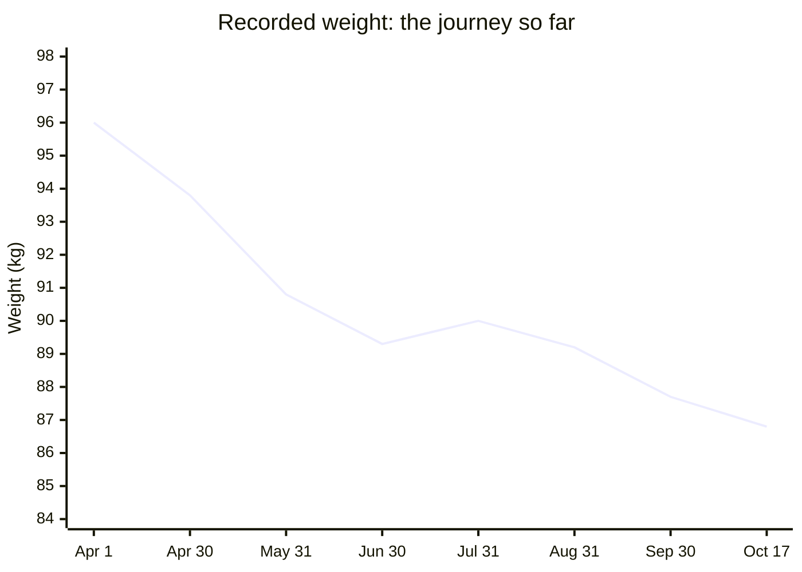
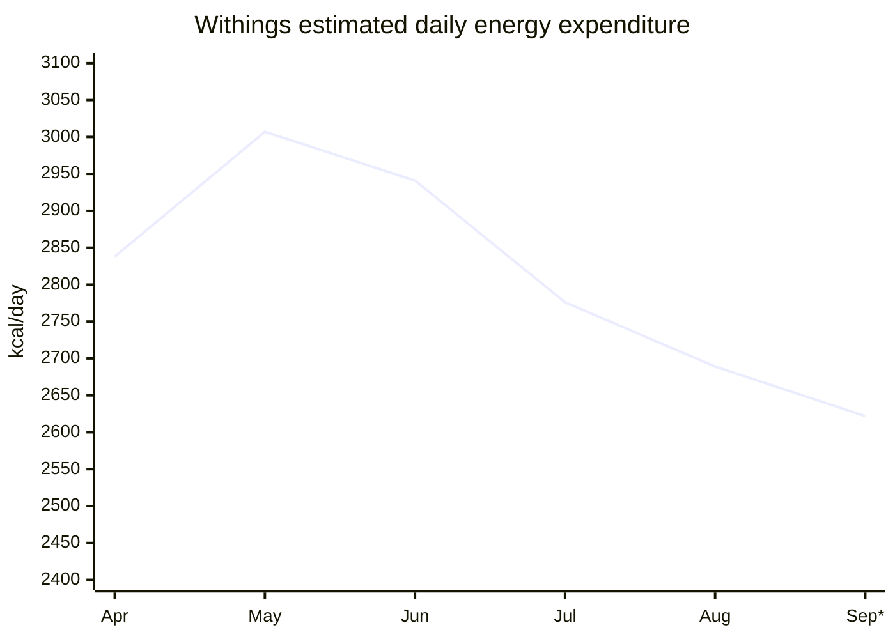
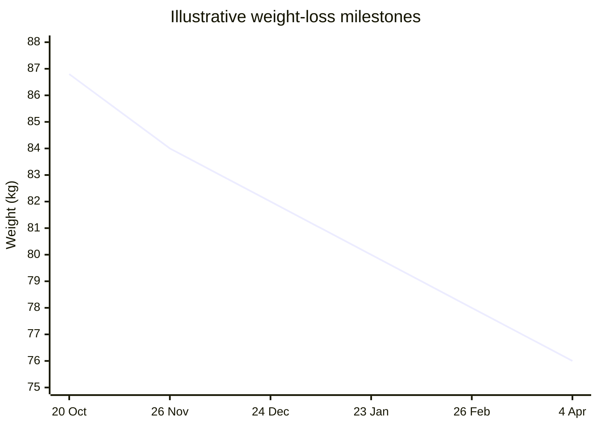
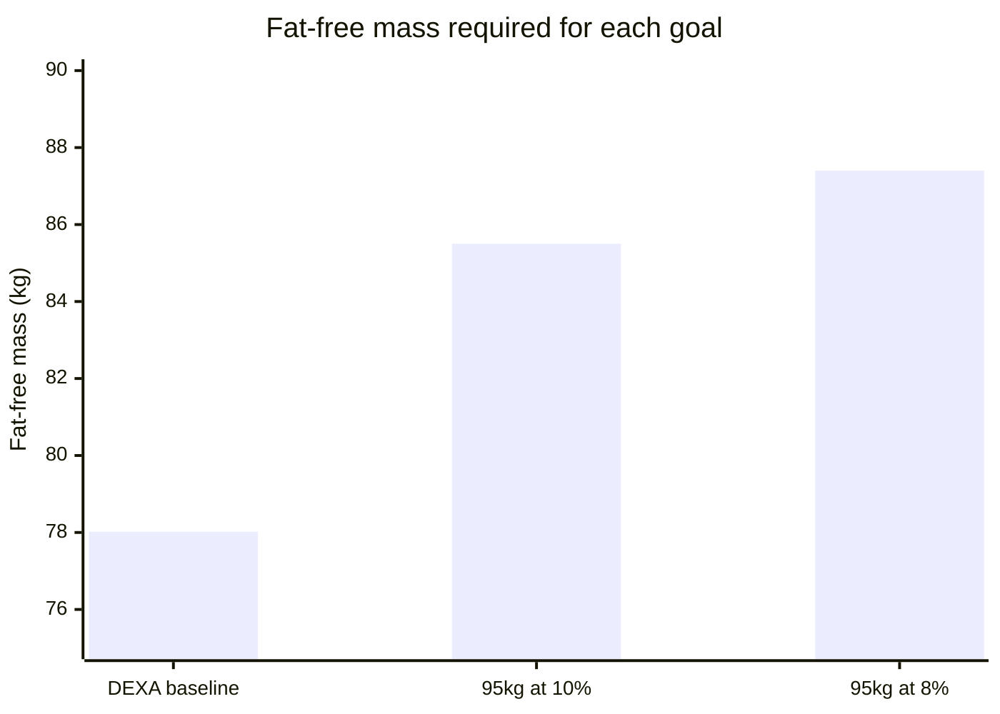
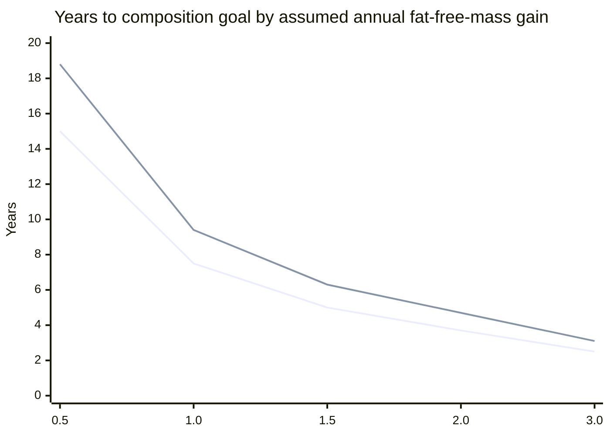
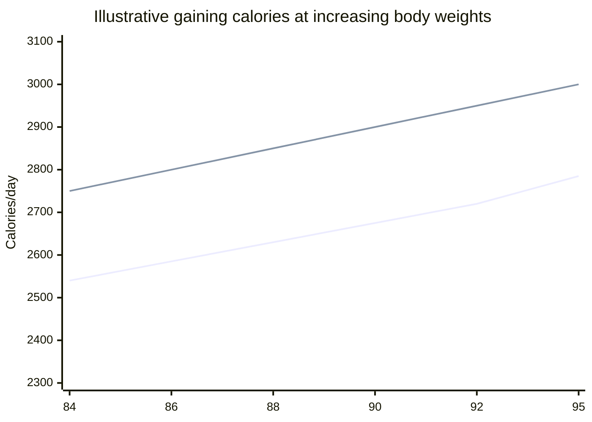

# My fitness journey: from 96 kg to a leaner, stronger 95 kg

*A data-driven personal plan, drafted 20 October 2026. This is a snapshot, not a medical recommendation or a guarantee.*

## Where I started, and where I am

In April 2026, I weighed **96.0 kg**. By **17 October 2026**, my most recently recorded weight was **86.8 kg**, a reduction of **9.2 kg (9.6%)**. My weight has not dropped in a straight line. There have been periods of disciplined dieting and periods when I didn't track my meals, particularly over the middle of the year.

| Milestone | Weight | Meaning |
| --- | ---: | --- |
| 1 April 2026 | 96.0 kg | Opening recorded weight |
| 7 September 2026 | 90.4 kg | DEXA body-composition scan |
| 17 October 2026 | 86.8 kg | Most recent changed scale reading |
| April 2027 | To be decided | Start of a controlled muscle-gain phase |
| Long-term | 95.0 kg at 10% or 8% body fat | Ambitious composition goal |

### The scale tells a story, but not the whole story

*Monthly readings show checkpoints, not an uninterrupted decline. Some entries in the exported weight series are carried forward between weigh-ins.*

## How my diet and activity fit together

My intended cutting diet is **1,800 calories per day**. On weeks when I eat out twice, the plan assumes roughly **600 additional calories per meal compared with the planned meal**, which makes the *effective* daily average approximately **1,971 kcal**.

But missing food records cannot be interpreted as zero calories. From 203 diary days, **135** include some food entries, **68** have none, and many of the logged days may be partial. Those gaps mean the diary does not prove exactly how much I ate on average.

My Withings activity export, covering **1 April to 11 September 2026**, estimates approximately **2,834 kcal/day** total expenditure across its records. It also shows estimated expenditure declining as my weight and activity changed:

| Month | Wearable-estimated TDEE (kcal/day) |
| --- | ---: |
| April | 2,838 |
| May | 3,007 |
| June | 2,941 |
| July | 2,776 |
| August | 2,689 |
| September 1–11 | 2,622 |

*Withings totals include activity calories; workout calories must not be added again. September covers only 11 days. Devices estimate energy use, rather than measure it directly.*

### My current TDEE estimate

My working estimate at **86.8 kg** is **2,600 kcal/day**, with a planning range of **2,450–2,750**. It's a calibrated starting assumption from past wearable data, **not a validated metabolic measurement**. My actual rate of weight change during several weeks of complete tracking will matter more.

## The remainder of the cut

Under a simple energy-balance model starting on **20 October 2026**, with an effective intake of ~1,971 kcal/day, starting TDEE of 2,600 and an assumed reduction in expenditure of 22 kcal/day for each kilogram lost:

| Target | Illustrative arrival date | Difference from 86.8 kg |
| --- | --- | ---: |
| 84 kg | 26 Nov 2026 | −2.8 kg |
| 82 kg | 24 Dec 2026 | −4.8 kg |
| 80 kg | 23 Jan 2027 | −6.8 kg |
| 78 kg | 26 Feb 2027 | −8.8 kg |
| 76 kg | 4 Apr 2027 | −10.8 kg |

**A critical qualification:** these are *mathematical what-if targets*, not a recommendation to reach 76 kg. My September DEXA shows approximately **78.0 kg fat-free mass**. If that quantity were fully maintained, reaching 80 kg would imply dangerously little remaining fat; at 76 kg the arithmetic would be impossible. A repeat DEXA and a health assessment should determine when this cut stops. In practice, the plan is to **reassess at around 84 kg** rather than insist on the lowest scale number.

## Maintaining until April 2027

The idea is to hold a stable, sustainable body weight through April, rebuild consistency around training and food, and enter a gaining phase from a well-measured baseline.

| If I maintain at… | Estimated maintenance calories per day |
| --- | ---: |
| 84 kg | 2,540 |
| 82 kg | 2,495 |
| 80 kg | 2,450 |
| 78 kg | 2,405 |
| 76 kg | 2,360 |

*These are hypothetical maintenance values, not endorsements of all the target weights. They assume similar daily activity and an expenditure change of roughly 22 kcal/day per kg.*

My practical approach: raise intake toward estimated maintenance when I finish the cut, accept the normal initial water/glycogen rebound, track seven-day weight averages, and adjust by around 100–150 kcal/day if a trend persists over several weeks.

## The bigger goal: 95 kg, lean

At **177 cm**, my long-term ambition is **95 kg at 10% body fat**, with **8%** as an even harder alternative. The difference sounds small, but the amount of fat-free mass required is considerable.

My **7 September 2026 DEXA** measured approximately **74.805 kg lean soft tissue**, **3.216 kg bone mineral**, and **12.424 kg fat**, giving approximately **78.021 kg total fat-free mass**. EVOLT bioimpedance estimates in the workbook were higher, and the two methods should not be treated as interchangeable.

| Measure | 95 kg at 10% | 95 kg at 8% |
| --- | ---: | ---: |
| Fat mass | 9.5 kg | 7.6 kg |
| Required fat-free mass | **85.5 kg** | **87.4 kg** |
| More fat-free mass than September DEXA | **+7.48 kg** | **+9.38 kg** |
| FFMI at 177 cm | 27.3 | 27.9 |

**Fat-free mass is not the same as skeletal muscle:** it also includes water, glycogen, bone and organs. Gains in these compartments should not be mistaken for kilograms of newly developed muscle.

### What could the timeline look like?

There is no honest way to predict an exact arrival year from one DEXA and periodic EVOLT estimates. Instead, these are transparent scenario calculations based on different average annual gains in fat-free mass, assuming the starting amount is still 78.0 kg in April 2027:

| Average additional fat-free mass each year | 95 kg at 10% | 95 kg at 8% |
| --- | ---: | ---: |
| 0.5 kg | ~15 years | ~19 years |
| 1.0 kg | ~7.5 years | ~9.4 years |
| 1.5 kg | ~5.0 years | ~6.3 years |
| 2.0 kg | ~3.7 years | ~4.7 years |
| 3.0 kg | ~2.5 years | ~3.1 years |

*First line: 10% body fat; second line: 8%. Years start in April 2027; they exclude separate cutting phases. High sustained rates may be unrealistic for an already muscular, experienced lifter. The endpoint itself may not be achievable or healthy to maintain.*

## My April 2027 gaining plan

If I finish maintenance at about **84 kg**, the provisional starting point is **~2,750 kcal/day**, around 200 above estimated maintenance. If my maintenance is different by April, I will use the **measured** value instead.

| Body weight | Planning maintenance | Provisional gaining intake |
| --- | ---: | ---: |
| 84 kg | 2,540 | 2,750 |
| 86 kg | 2,585 | 2,800 |
| 88 kg | 2,630 | 2,850 |
| 90 kg | 2,675 | 2,900 |
| 92 kg | 2,720 | 2,950 |
| 95 kg | 2,785 | 3,000 |

*Lower line: maintenance estimate. Upper line: initial gaining intake. Training load, spontaneous movement and metabolic adaptation can shift both.*

The intention isn't to gain weight as fast as possible. A sensible initial target is approximately **0.1–0.2 kg per week**, evaluating several-week trends in weight, waist, strength and training quality. The provisional 2,750-calorie macros are **185 g protein, 80 g fat and 323 g carbohydrates**.

## The checkpoints that matter

1. **Finish the cut safely:** repeat DEXA and choose a sensible stopping point based on body composition, not simply a scale target.
2. **Maintain through April 2027:** ensure weight, training performance and food intake are stable.
3. **Begin a controlled gaining phase:** start around 200 kcal above observed maintenance, then adjust to measured response.
4. **Aim for 80 kg measured fat-free mass, then 82–83 kg:** use repeat body-composition assessments to keep projections honest.
5. **Reassess the 95 kg goal regularly:** staying healthy and retaining gains matters more than pursuing an arbitrary date.

### How I will measure progress

I plan to record morning weigh-ins and food intake, use activity data to monitor movement, track lifting performance and waist circumference, and consider repeat DEXA measurements roughly every 4–6 months where appropriate.

I also need to be careful interpreting changes during or after anabolic-steroid exposure: fluid balance and muscle retention can change, while cardiovascular and hormonal risks can be substantial. Any use needs appropriate clinical review rather than relying on a spreadsheet to declare it safe.

---

**Bottom line:** I've lost **9.2 kg** since April 2026. The next objective is to reach a sustainable, lean condition and maintain it through April 2027. The later 95 kg ambition is about **building and retaining another ~7.5–9.4 kg of fat-free mass relative to my September DEXA**, not just pushing my scale weight upward. That is a long-term project, and the 10% and 8% cases should be treated as ambitions rather than guaranteed outcomes.

*Inputs: committed MyFitnessPal diary/weight exports, previously reviewed Withings April–September 2026 activity export, and September 2026 DEXA values from the body-composition workbook. The Withings and DEXA source files should be archived alongside this report if the analysis is to be reproducible by others. All projections are assumptions, not observed outcomes.*
